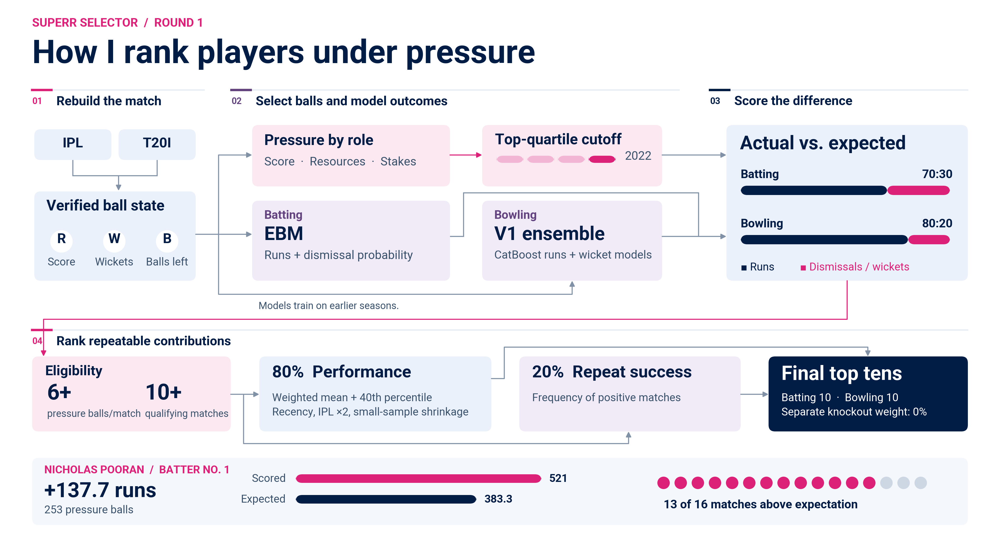

# SupeRR Selector Season 2

## Final model

Batting uses EBM. Bowling uses the V1 ensemble. The separate decisive-match adjustment is 0%. Qualifying knockout deliveries contribute through the pressure score.

The verified cohort contains 339 IPL and 321 T20I matches. The 2022 season sets reference thresholds and scales. Rankings use the 2023–2026 chronological replay.

## Results

The results folder includes final_top_tens.csv, full batting and bowling rankings, and report_evidence.csv with contribution and consistency figures. The evidence file also includes internal sensitivity diagnostics.

## Quick verification

Run `python3 reproduce_rankings.py` to recreate the selected twenty names from the aggregate ranking tables and verify agreement with the saved final selection. Only the Python standard library is required.

## Method

1. Reconstruct pre-ball states and verify extras.
2. Select pressure balls using role-specific 2022 75th-percentile cutoffs.
3. Predict expected runs and wickets using earlier seasons.
4. Compare outcomes with expectation. Standardized run and wicket weights are 70:30 for batting and 80:20 for bowling.
5. Require six pressure balls per match and ten qualifying matches.
6. Blend weighted mean and weighted 40th percentile at 70:30, apply recency and IPL 2:1 performance weighting, and shrink small samples.
7. Combine performance percentile (80%) with repeat-success percentile (20%). Repeat credit equals positive matches squared divided by qualifying matches.

## Full analysis code

The src folder preserves the analysis scripts, including experimental alternatives. The final model choice is specified above.

Important files are audit.py, ipl_extras.py, build_t20i_data.py, rerun_combined.py, combined_pressure_trial.py, compare_v1_candidates.py and submission_selection.py.

Use Python 3.9 and install requirements.txt for the modelling environment. Full delivery-level replay requires the competition data pack, local Cricsheet archives, previously verified feature tables and pre-2022 history seeds. These inputs are excluded from this public bundle. The quick verification reproduces the selection from aggregate outputs rather than retraining the models.

Paths in src are relative to the repository root and retain the original data-folder names. With the prepared inputs available, the replay runs rerun_combined.py, league_stakes_audit.py, combined_pressure_trial.py and compare_v1_candidates.py. The combined replay expects verified IPL/T20I inputs and warm-history seeds first.

## Interpretation and attribution

The rankings describe performance in selected pressure situations, which arise more often late in an innings. Small samples and opponent differences matter for close decisions. Evaluation seasons were reused during development, so prediction errors are development evidence.

Competition delivery and fixture records supply the analysis. Local Cricsheet JSON records verify extras and ordering. This bundle contains code, figures and aggregate results.
